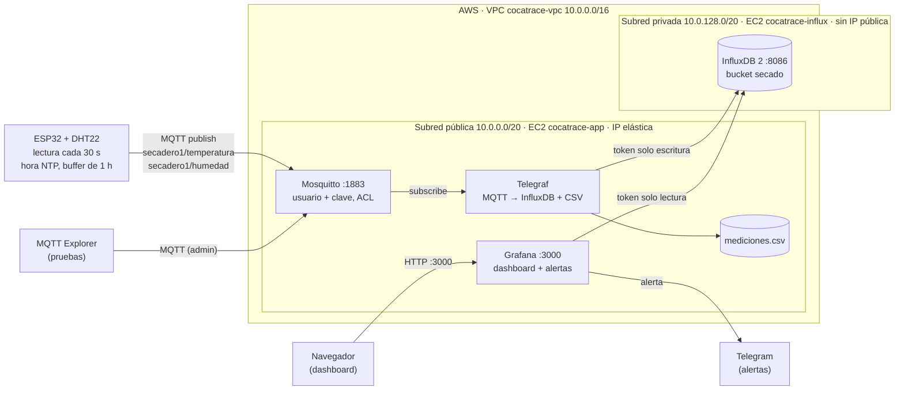

# CocaTrace MQTT: bróker MQTT, InfluxDB y Grafana en AWS

Práctica 2 de *Inteligencia Artificial aplicada a IoT* (Especialización en IA). Un ESP32 con un sensor DHT22 mide la **temperatura y la humedad del secadero de hoja de coca** y las publica por **MQTT** en un bróker **Mosquitto** en AWS. **Telegraf** guarda cada lectura en **InfluxDB** (base de datos de series de tiempo) y en un **CSV**. **Grafana** muestra los datos y envía **alertas por Telegram**.

Es parte del proyecto de trazabilidad de bioproductos de hoja de coca (Minciencias): cada lectura queda asociada al secadero y a su hora real de medición.

## Arquitectura



| Componente | Dónde | Versión | Función |
|---|---|---|---|
| ESP32 DevKit + DHT22 | Secadero | — | Mide cada 30 s y publica por MQTT |
| Mosquitto | EC2 pública | 2.0.18 | Bróker MQTT, puerto 1883, con autenticación |
| Telegraf | EC2 pública | 1.40.2 | Se suscribe a los topics y escribe en InfluxDB y en el CSV |
| InfluxDB 2 | EC2 **privada** | 2.9.1 | Base de datos de series de tiempo (org `cocatrace`, bucket `secado`) |
| Grafana | EC2 pública | 13.3.0 | Dashboard y alertas, puerto 3000 |

## Topics y mensajes

| Topic | Mensaje | Quién publica |
|---|---|---|
| `secadero1/temperatura` | `{"valor": 24.6, "ts": 1793461967}` | ESP32 |
| `secadero1/humedad` | `{"valor": 71.2, "ts": 1793461967}` | ESP32 |
| `secadero1/estado` | `conectado` / `desconectado` (retenido) | ESP32; el bróker publica `desconectado` si el ESP32 se cae (*Last Will*) |

- `ts` es la hora real de la medición (epoch UTC, sincronizada por NTP). Telegraf usa esa hora, no la de llegada. Así, las lecturas que el ESP32 guardó en su buffer mientras no tenía conexión conservan su hora correcta.
- En InfluxDB cada lectura queda en el *measurement* `ambiente`, con los tags `secadero` y `variable` y el campo `valor`.
- Telegraf descarta mensajes que no son JSON válido y valores fuera del rango del DHT22 (−40 a 80 °C, 0 a 100 %).

## Seguridad

**Grupos de seguridad**

| Grupo | Entrada permitida |
|---|---|
| `cocatrace-app` | 1883 (MQTT) y 3000 (Grafana) desde internet, ambos con usuario y clave; SSH 22 solo desde la IP del equipo |
| `cocatrace-influx` | 8086 (InfluxDB) y SSH 22 **solo desde el grupo `cocatrace-app`** |

**Mosquitto:** `allow_anonymous false`, claves en `password_file` y permisos por usuario en [`mosquitto/acl`](mosquitto/acl).

| Usuario | Permiso |
|---|---|
| `esp32` | Solo **publicar** en `secadero1/#` |
| `telegraf` | Solo **leer** `secadero1/#` |
| `admin` | Todo (para MQTT Explorer) |

**InfluxDB:** escucha solo en su IP privada. Usa dos tokens con el mínimo permiso: el de Telegraf **solo escribe** en el bucket `secado` y el de Grafana **solo lee**.

**Claves:** ninguna está en este repositorio. En los servidores van en `/etc/mosquitto/passwd`, `/etc/default/telegraf` y `/etc/default/grafana-server`, con permisos restringidos. En el ESP32 van en `config.h`, que está en `.gitignore`.

## Estructura

```
firmware/cocatrace_mqtt/     Código del ESP32 (Arduino) + config.example.h
mosquitto/                   Configuración del bróker y ACL
telegraf/telegraf.conf       MQTT -> InfluxDB + CSV
influxdb/config.toml         InfluxDB escuchando solo en la IP privada
grafana/provisioning/        Fuente de datos, carga del dashboard y alertas (Telegram)
grafana/dashboards/          Dashboard "CocaTrace - Secado de hoja de coca"
```

## Instalación

**EC2 de InfluxDB** (Ubuntu 24.04, subred privada). No tiene salida a internet: el paquete `.deb` de InfluxDB se descarga en la EC2 pública y se copia por SSH.

```bash
sudo dpkg -i influxdb2_*.deb influxdb2-cli_*.deb
sudo cp influxdb/config.toml /etc/influxdb/config.toml && sudo systemctl enable --now influxdb
influx setup --host http://<IP-privada>:8086 --username admin --org cocatrace --bucket secado --retention 0
influx auth create --org cocatrace --write-bucket <id-bucket> --description telegraf-escritura
influx auth create --org cocatrace --read-bucket <id-bucket> --description grafana-lectura
```

**EC2 pública** (Ubuntu 24.04, IP elástica), con los repositorios oficiales de InfluxData y Grafana:

```bash
sudo apt install mosquitto mosquitto-clients telegraf grafana
# Mosquitto
sudo cp mosquitto/cocatrace.conf /etc/mosquitto/conf.d/ && sudo cp mosquitto/acl /etc/mosquitto/acl
sudo mosquitto_passwd -c /etc/mosquitto/passwd esp32      # y luego: telegraf, admin (sin -c)
# Telegraf: claves en /etc/default/telegraf (MQTT_TELEGRAF_PASS, INFLUX_TOKEN)
sudo cp telegraf/telegraf.conf /etc/telegraf/telegraf.conf
# Grafana: claves en /etc/default/grafana-server (INFLUX_TOKEN_GRAFANA, TELEGRAM_BOT_TOKEN, TELEGRAM_CHAT_ID)
sudo cp -r grafana/provisioning/* /etc/grafana/provisioning/
sudo mkdir -p /var/lib/grafana/dashboards/cocatrace && sudo cp grafana/dashboards/cocatrace.json /var/lib/grafana/dashboards/cocatrace/
sudo systemctl enable --now mosquitto telegraf grafana-server
```

**ESP32:** copia `config.example.h` como `config.h` y pon el WiFi (2,4 GHz), la IP del bróker y la clave del usuario `esp32`. Librerías: `PubSubClient` (Nick O'Leary) y `DHT sensor library` (Adafruit). Conexión del DHT22: `+` → 3V3, `out` → GPIO4, `−` → GND.

## Verificación

| Qué | Cómo |
|---|---|
| El bróker recibe datos | MQTT Explorer → `<IP-elástica>:1883`, usuario `admin` → árbol `secadero1` |
| Datos en InfluxDB | `influx query 'from(bucket:"secado") \|> range(start:-1h) \|> last()'` en la EC2 privada |
| Datos en el CSV | `tail -f /var/lib/telegraf/mediciones.csv` en la EC2 pública |
| Visualización | `http://<IP-elástica>:3000` → Dashboards → CocaTrace |
| Sin usuario no entra | `mosquitto_pub -h <IP> -t secadero1/x -m 1` → `not authorised` |

## Alertas (Grafana → Telegram)

| Alerta | Condición |
|---|---|
| Humedad alta en el secadero | Humedad > 80 % |
| Temperatura alta en el secadero | Temperatura > 40 °C |
| El ESP32 dejó de enviar datos | Ninguna lectura en 3 minutos |

Los umbrales son de ejemplo y se ajustan en [`grafana/provisioning/alerting/cocatrace.yaml`](grafana/provisioning/alerting/cocatrace.yaml). El mensaje llega a un bot de Telegram creado con @BotFather.

## Nota sobre la subred de la base de datos

El enunciado pide "separar la base de datos en una subred pública". Pusimos InfluxDB en una subred **privada**, sin IP pública: solo la EC2 de la aplicación puede llegar a ella, por su grupo de seguridad. Es la práctica recomendada para una base de datos y la misma decisión de la Práctica 1.
